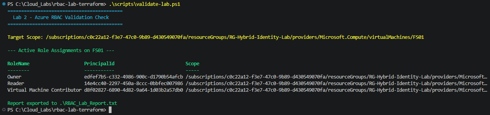
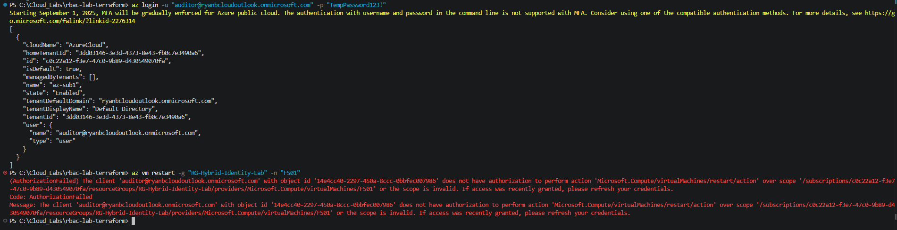
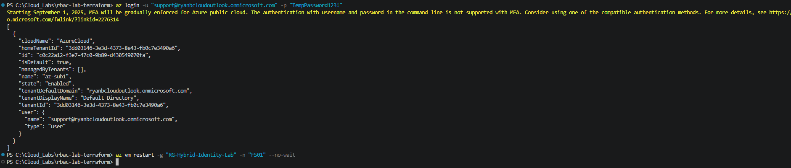

# Lab 2: Scoped Azure RBAC & Least Privilege Governance via Terraform

## Overview
This phase enforces the **Principle of Least Privilege (PoLP)** across cloud workloads by defining granular, resource-scoped Role-Based Access Control (RBAC) policies via Terraform. Rather than granting broad subscription- or resource-group-level rights, permissions are strictly confined to individual target resources (`FS01`).

---

## Architecture & Role Mapping

All role assignments are declared as code using HashiCorp Terraform and scoped explicitly to `/subscriptions/<subscription-id>/resourceGroups/RG-Hybrid-Identity-Lab/providers/Microsoft.Compute/virtualMachines/FS01`.

| Identity Persona | Assigned Azure RBAC Role | Scope | Permitted Capabilities | Boundary Restriction |
| :--- | :--- | :--- | :--- | :--- |
| **Lab-SysAdmin** | `Owner` | `FS01` Virtual Machine | Full administrative control & IAM assignment delegation on `FS01`. | No inherited control over the domain controller (`DC01`) or virtual network. |
| **Lab-Support** | `Virtual Machine Contributor` | `FS01` Virtual Machine | Power actions (`start`, `restart`, `deallocate`) and maintenance on `FS01`. | Cannot assign permissions or access underlying guest OS data without direct credentials. |
| **Lab-Auditor** | `Reader` | `FS01` Virtual Machine | Read-only inspection of VM metadata, settings, and monitoring logs. | Execution of compute actions (e.g., `Microsoft.Compute/virtualMachines/restart/action`) is strictly denied. |

---

## Infrastructure as Code Implementation

* **State Decoupling:** RBAC assignments are managed in a isolated Terraform workspace (`rbac-lab-terraform`), consuming target resource IDs dynamically via data sources or scoped variables to prevent state contamination with base VM deployments.
* **Declarative Assignments:** Role definitions utilize `azurerm_role_assignment` tied to Entra ID User Object IDs.

```hcl
resource "azurerm_role_assignment" "fs01_support_contributor" {
  scope                = var.fs01_resource_id
  role_definition_name = "Virtual Machine Contributor"
  principal_id         = var.support_object_id
}
```

---

## Empirical Verification & Boundary Enforcement

Validation was conducted via automated inspection scripts and live persona emulation through Azure CLI.

### 1. Terraform State & Assignment Verification
The automated verification script queries Azure Resource Manager for all role bindings applied to the VM scope:

```powershell
.\scripts\validate-lab.ps1
```



*Result:* Confirmed all three identities resolve strictly to target scope `/providers/Microsoft.Compute/virtualMachines/FS01`.

---

### 2. Least Privilege Boundary Test (Auditor Persona)
Simulated authentication as `auditor@...` to verify enforcement of the read-only boundary:

```powershell
az login -u "auditor@ryanbcloudoutlook.onmicrosoft.com" -p "<redacted>"
az vm restart -g "RG-Hybrid-Identity-Lab" -n "FS01"
```



```text
(AuthorizationFailed) The client 'auditor@...' does not have authorization to perform action 
'Microsoft.Compute/virtualMachines/restart/action' over scope 
'/subscriptions/.../resourceGroups/RG-Hybrid-Identity-Lab/providers/Microsoft.Compute/virtualMachines/FS01'.
```
*Result:* **PASS**. Action explicitly denied by the ARM authorization engine.

---

### 3. Authorized Control Test (Support Persona)
Authenticated as `support@...` to verify operational entitlement:

```powershell
az login -u "support@ryanbcloudoutlook.onmicrosoft.com" -p "<redacted>"
az vm restart -g "RG-Hybrid-Identity-Lab" -n "FS01" --no-wait
```



*Result:* **PASS**. The request was accepted and executed without authorization barriers.

---

## Key Takeaways
1. **Lateral Movement Mitigation:** Limiting cloud operations personas to specific workload endpoints prevents compromise of adjacent Tier-0 resources like `DC01`.
2. **Deterministic Governance:** Defining access through Terraform allows security teams to peer-review identity changes via pull requests and eliminate configuration drift.

## Troubleshooting & Lessons Learned

* **RBAC Token Caching & Propagation Delays:** 
  * **Issue:** After successfully applying the role assignments via Terraform, attempting to execute a VM restart command immediately via Azure CLI resulted in an `AuthorizationFailed` error stating: *"If access was recently granted, please refresh your credentials."*
  * **Resolution:** Azure RBAC assignments can take a few minutes to propagate across the control plane, and existing CLI sessions cache access tokens. Running `az logout` and re-authenticating forced a fresh token claim, allowing the newly assigned permissions to apply correctly.

* **Protecting Infrastructure State & Credentials:** 
  * **Issue:** Terraform local state (`.tfstate`) and variable files (`.tfvars`) often contain sensitive Object IDs, tenant information, and infrastructure metadata that must not be exposed in public repositories.
  * **Resolution:** Implemented a strict `.gitignore` prior to the initial commit to ensure local state files and provider locks were decoupled from version control, preventing credential leakage.